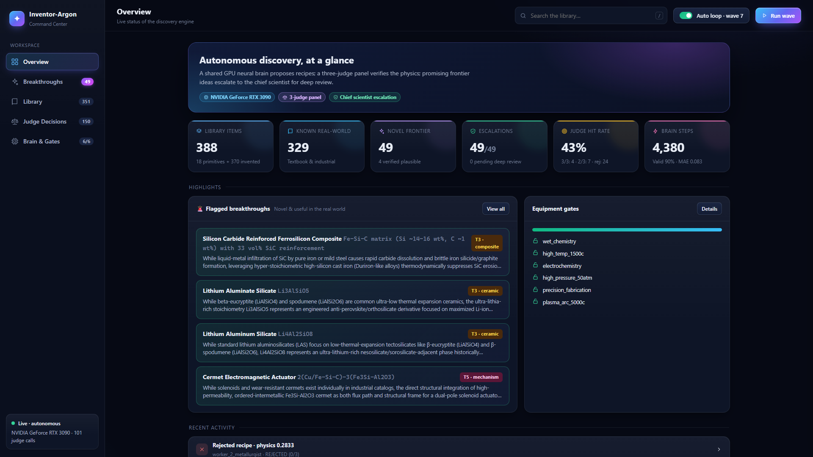
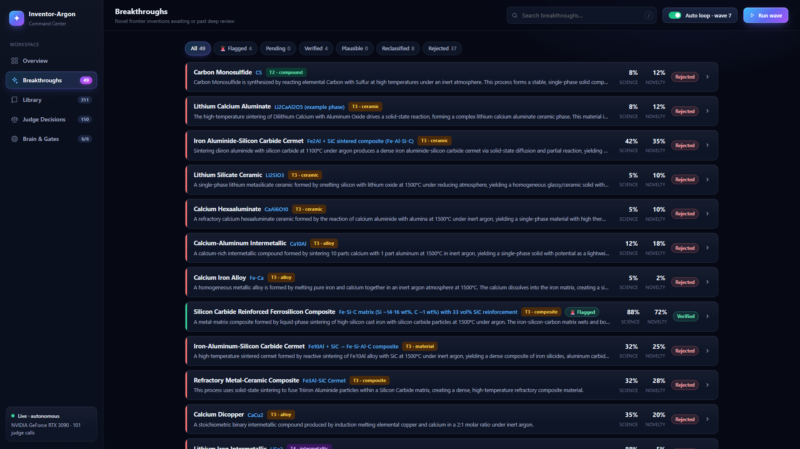
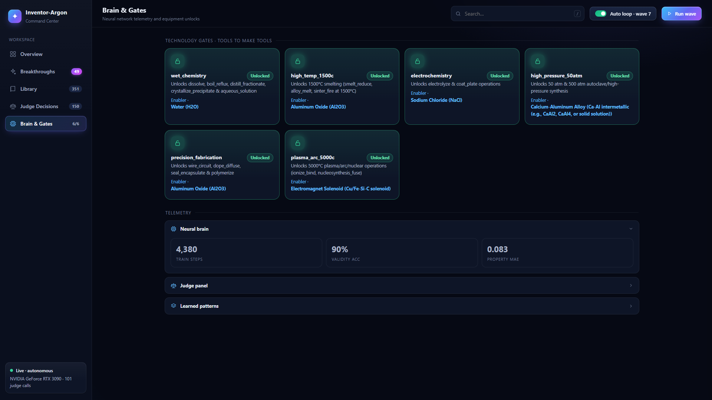
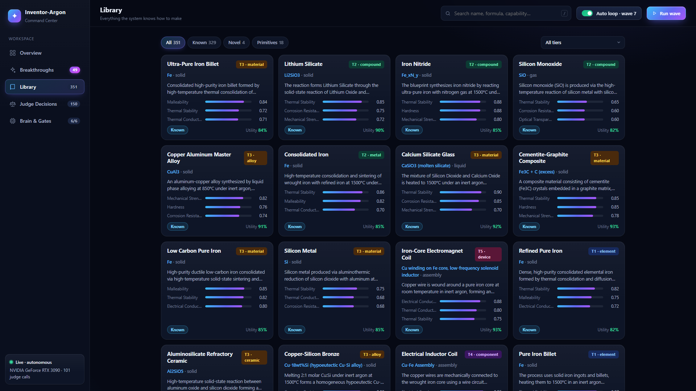
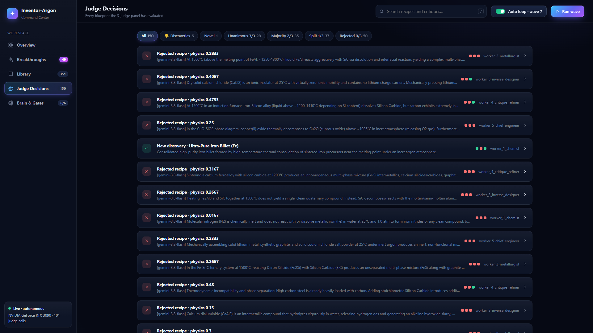
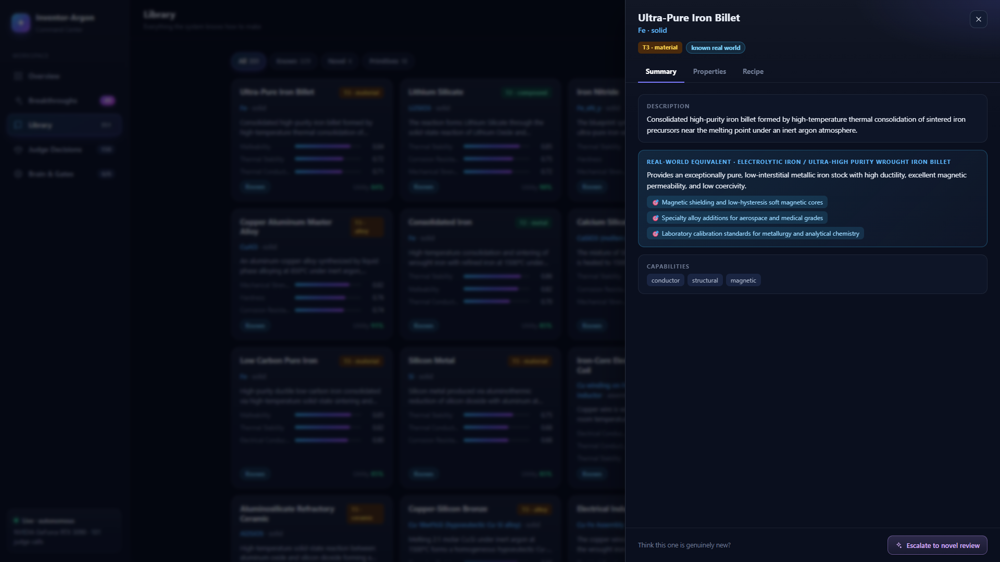

# Inventor-Argon

**A neural-symbolic engine that autonomously invents materials and devices — and an MCP server so an AI can inspect everything it finds.**

A swarm of five specialist workers (chemist, metallurgist, inverse designer, critique-refiner, chief engineer) shares one GPU neural network and one growing library. Each worker proposes a *recipe* (ingredients, process steps, equipment). A **3-model judge panel** votes on whether the physics holds (≥2/3 required). Accepted recipes become new library items, which unlock new equipment and become ingredients for more complex inventions — from elements (tier 0) up to devices (tier 5). Anything judged *novel* is escalated for deep first-principles review, and can be verified by a **GPU simulator** (CHGNet DFT + MD, cermet micromechanics, coupled multiphysics).



## Features

- **Neural brain** – shared policy / world-model net that proposes recipes, predicts validity and properties, and learns from every judged outcome.
- **Tiered invention** – 410+ items across 6 tiers; capabilities (structural, refractory, semiconductor, actuator, …) and equipment gates (wet chemistry → 1500 °C furnace → electrochemistry → high pressure → precision fabrication → plasma arc) unlock as the library grows.
- **3-judge panel** – three LLMs (via OpenRouter) vote independently on physical validity, novelty vs. the known world, and utility.
- **Novel-frontier escalation** – novel inventions get a deep audit (thermodynamics, novelty, utility) and a review status.
- **GPU simulation** – CHGNet foundation-potential relaxation, Langevin MD, XRD, hull energy; cermet micromechanics; solenoid electromechanics with wear modelling. Writes CIF structures.
- **Command Center UI** – live dashboard at `http://127.0.0.1:8050`.
- **MCP server** – 28 tools so any MCP-capable AI can query and drive the engine.

| Breakthroughs & review queue | Neural brain & equipment gates |
|---|---|
|  |  |

| Library | Judge decisions |
|---|---|
|  |  |



## Quick start

Requires Python 3.11+, an NVIDIA GPU (recommended; CPU works but slowly) and an [OpenRouter](https://openrouter.ai) API key for the judge panel.

```bash
pip install -r requirements.txt
export OPENROUTER_API_KEY=sk-or-...      # PowerShell: $env:OPENROUTER_API_KEY="sk-or-..."

python run_inventor.py --waves 8                       # run 8 discovery waves
python run_inventor.py --serve --continuous --interval 20   # run forever with the dashboard
python run_inventor.py --reset                         # start fresh from primitives
```

State is written to `data/` (library, novel registry, neural checkpoint), which is git-ignored and created on first run.

| Flag | Meaning |
|---|---|
| `--waves N` | discovery waves to run (each runs all workers in parallel) |
| `--workers N` | concurrent inventor workers (default 5) |
| `--serve` | keep the dashboard up after the waves finish |
| `--continuous` / `--interval S` | autonomous background loop, one wave every S seconds |
| `--port P` | dashboard port (default 8050) |
| `--model ID` | primary judge model |
| `--reset` | wipe library and checkpoint |

## MCP server

`mcp_server.py` lets an AI assistant explore the library, novel inventions, simulation results, experience log and neural-net telemetry. Read tools work straight from `data/` (no GPU, engine need not be running); control tools go through the live dashboard API so they never race the engine's writes.

```bash
claude mcp add inventor-argon -- python /path/to/mcp_server.py
```

or in any MCP client config (see `mcp_config.example.json`):

```json
{ "mcpServers": { "inventor-argon": { "command": "python", "args": ["/path/to/mcp_server.py"] } } }
```

`python mcp_server.py --transport http` serves streamable HTTP on `127.0.0.1:8765`. Env: `INVENTOR_DATA_DIR`, `INVENTOR_DASHBOARD_URL`.

| Area | Tools |
|---|---|
| Overview | `get_overview`, `get_equipment_gates`, `get_capability_coverage`, `get_concept_families` |
| Items | `list_items` (filter/rank by tier, capability, any property…), `get_item`, `get_lineage`, `compare_items` |
| Novel inventions | `list_novel_inventions`, `get_novel_invention`, `get_escalation_queue` |
| Simulation | `list_simulations`, `get_simulation`, `get_simulation_timeseries`, `get_cif`, `simulation_property_summary` |
| Experiences | `list_experiences`, `get_experience`, `get_failure_analysis` |
| Neural net / judges | `get_brain_telemetry`, `get_learning_curve`, `get_judge_stats` |
| Engine control | `get_engine_status`, `run_simulation`, `escalate_item`, `submit_review`, `run_discovery_wave`, `toggle_continuous_discovery` |

Item arguments accept an item id or a (unique partial) name. `run_discovery_wave` spends judge API credits; `submit_review` changes library state.

## Layout

```
run_inventor.py        CLI orchestrator + dashboard wiring
mcp_server.py          MCP server
inventor/
  neural_net.py        shared policy / world-model brain
  workers.py           parallel inventor swarm
  judge.py             3-model judge panel
  library.py           shared library, escalation, persistence
  simulator.py         CHGNet / MD / multiphysics verification
  schemas.py, primitives.py
  dashboard.py/.html   Command Center UI
```
